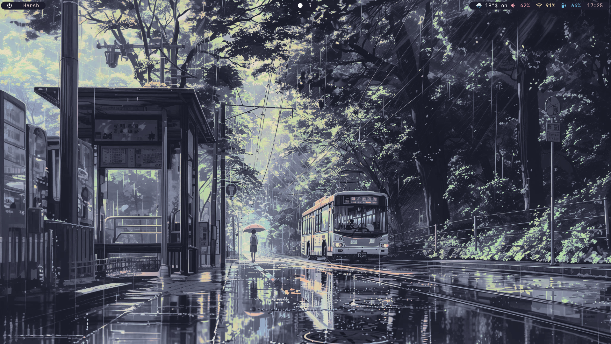
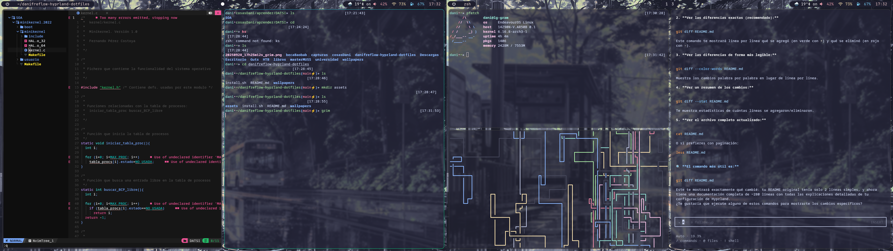
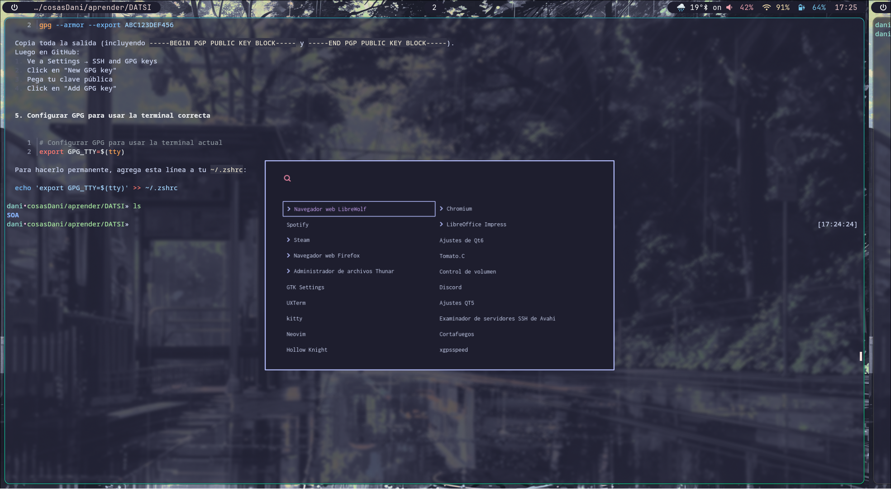

# danifreflow hyprland dotfiles 🐧

Personal Hyprland dotfiles configuration with Catppuccin Mocha theme and Wayland-optimized applications.

## Table of Contents

- [Features](#features)
- [Screenshots](#screenshots)
- [Installation](#installation)
- [Configuration](#configuration)
- [Monitors](#monitors)
- [Keyboard Shortcuts](#keyboard-shortcuts)
- [Components](#components)
- [Waybar Modules](#waybar-modules)
- [Customization](#customization)

## Features

- **Compositor**: Hyprland with smooth animations and visual effects
- **Theme**: Catppuccin Mocha (warm and elegant colors)
- **Status Bar**: Waybar with custom modules
- **Terminal**: Kitty with optimized configuration
- **Launcher**: Wofi with modern design
- **Notifications**: Mako with consistent styling
- **File Managers**: Yazi (terminal, keyboard-driven) and Thunar (GTK, mouse-friendly)
- **Icons**: Papirus-Dark with Catppuccin Mocha mauve folders
- **Screen Lock**: Hyprlock with elegant design
- **Power Management**: Hypridle for automatic suspension

## Screenshots

### Single Monitor Setup


### Dual Monitor Setup


### Wofi Launcher


## Installation

The installer detects your distribution, installs every dependency, backs up
your current `~/.config` and copies the dotfiles and the wallpaper.

| Distribution | Support |
|---|---|
| Arch Linux and derivatives (EndeavourOS, CachyOS, Manjaro...) | Full: official repos + AUR |
| Ubuntu 24.04+ and derivatives (**Slimbook OS**, Kubuntu, Pop!_OS, Mint...) | Full: Hyprland from [`ppa:cppiber/hyprland`](https://launchpad.net/~cppiber/+archive/ubuntu/hyprland) |
| Any other distro | Dotfiles only (`--dotfiles-only`), install the packages yourself |

```bash
git clone https://github.com/tuusuario/danifreflow-hyprland-dotfiles.git
cd danifreflow-hyprland-dotfiles
./install.sh
```

Then log out and pick **Hyprland** in your login screen (SDDM, GDM...).

### Options

```bash
./install.sh                  # packages + dotfiles
./install.sh --dotfiles-only  # only copy dotfiles and wallpapers (any distro)
./install.sh --packages-only  # only install packages
```

### What the installer does

- **Arch**: installs everything with `pacman`, and `wlogout`, `bzmenu`, `wttrbar` from AUR (installs `yay` if no AUR helper is present).
- **Ubuntu / Slimbook OS**: adds the Hyprland PPA (signed key, no `add-apt-repository` needed), installs the packages with `apt`, downloads the `bzmenu` and `wttrbar` binaries from GitHub to `/usr/local/bin` and the JetBrainsMono / Inconsolata Nerd Fonts to `~/.local/share/fonts`.
- **Dotfiles**: backs up any existing config to `~/.config-backup/<date>/`, copies everything to `~/.config`, rewrites absolute paths to your `$HOME`, copies the wallpaper to `~/wallpapers` and creates `~/capturas` for screenshots.
- `~/.config/hypr/monitors.lua` is **never overwritten** if it already exists, since monitors are specific to each machine.
- Finally it validates the Hyprland config with `Hyprland --verify-config`.

### Requirements

- **Hyprland >= 0.55** for the main Lua config (`hyprland.lua`). On older versions Hyprland falls back to the legacy `hyprland.conf`.
- On Ubuntu-based distros, **24.04 (noble) or newer**: on 22.04 the PPA only ships Hyprland 0.54.

### Dependencies (for other distros)

`hyprland` (>= 0.55) `hyprpaper` `hypridle` `hyprlock` `xdg-desktop-portal-hyprland` `waybar` `kitty` `thunar` `wofi` `wlogout` `mako` `zathura` `pavucontrol` `brightnessctl` `grim` `slurp` `wl-clipboard` `playerctl` `wlsunset` `networkmanager` `python-gobject` `qt6ct` `kvantum` `bzmenu` `wttrbar` + JetBrainsMono and Inconsolata Nerd Fonts.

## Configuration

### File Structure

```
├── .config/
│   ├── hypr/
│   │   ├── hyprland.lua    # Main Hyprland config (Hyprland >= 0.55)
│   │   ├── monitors.lua    # Per-machine monitor layout (never overwritten)
│   │   ├── hyprland.conf   # Legacy config, only used by Hyprland < 0.55
│   │   ├── hyprlock.conf / hypridle.conf / hyprpaper.conf / mocha.conf
│   ├── waybar/         # Status bar and modules
│   ├── kitty/          # Terminal
│   ├── wofi/           # Application launcher
│   ├── mako/           # Notification system
│   ├── wlogout/        # Logout menu
│   ├── yazi/           # Terminal file manager (theme + drag & drop keymap)
│   └── zathura/        # PDF viewer
├── assets/             # Screenshots
├── wallpapers/         # Wallpapers
├── scripts/
│   ├── common.sh       # Shared helpers + dotfiles deployment
│   ├── arch.sh         # Arch / EndeavourOS packages
│   └── ubuntu.sh       # Ubuntu / Slimbook OS packages
└── install.sh          # Installer (detects the distro)
```

## Keyboard Shortcuts

### Basic Navigation
| Shortcut | Action |
|----------|--------|
| `Super + T` | Open terminal (Kitty) |
| `Super + D` | Open launcher (Wofi) |
| `Super + E` | Open file manager (Thunar) |
| `Super + R` | Open terminal file manager (Yazi) |
| `Super + V` | Toggle floating window |
| `Super + Shift + E` | Exit Hyprland |

### Window Management
| Shortcut | Action |
|----------|--------|
| `Super + H/J/K/L` | Navigate between windows (left/down/up/right) |
| `Super + Shift + H/J/K/L` | Move active window |
| `Super + Shift + Q` | Close active window |
| `Super + P` | Toggle pseudotiling |
| `Super + O` | Toggle window split (side by side ↔ stacked) |

### Workspaces
| Shortcut | Action |
|----------|--------|
| `Super + 1-9,0` | Switch to workspace |
| `Super + Shift + 1-9,0` | Move window to workspace |
| `Super + S` | Special workspace (scratchpad) |
| `Super + Shift + S` | Move window to scratchpad |

### System Functions
| Shortcut | Action |
|----------|--------|
| `Print` | Screenshot (selected area) |
| `Super + Z` | Lock screen |
| `Super + B` | Open Bluetooth menu (bzmenu) |
| `Super + M` | Move the laptop screen to the other side of the external monitors |

### Multimedia Keys
| Key | Action |
|-----|--------|
| `XF86AudioRaiseVolume` | Increase volume |
| `XF86AudioLowerVolume` | Decrease volume |
| `XF86AudioMute` | Mute audio |
| `XF86MonBrightnessUp/Down` | Brightness control |
| `XF86AudioNext/Prev/Play` | Media control |

## Components

### Hyprland (`hyprland.lua`)

Since Hyprland 0.55 the config is written in Lua and `hyprland.conf` (hyprlang)
is deprecated; it will stop being read in 0.57. `hyprland.conf` is kept only as
a fallback for older Hyprland versions. Validate changes with:

```bash
Hyprland --verify-config -c ~/.config/hypr/hyprland.lua
```

**Main compositor** that manages windows, animations and visual effects.

**Main features:**
- **Layout**: Dwindle (spiral windows)
- **Gaps**: 5px internal, 10px external
- **Borders**: 1px with active gradient colors
- **Animations**: Smooth with custom bezier curves
- **Transparency**: Blur and shadow effects
- **Power management**: Integration with hypridle

**Special configurations:**
- Automatic laptop screen closure and monitor arrangement (`monitors.lua`)
- Optimized XWayland scaling
- Window rules for specific applications

### Kitty (`kitty.conf`)

**Terminal emulator** with development-optimized configuration.

**Features:**
- Font: JetBrainsMono Nerd Font
- Theme: Catppuccin Mocha
- Transparency and visual effects
- Tab and window configuration
- Wayland integration

### Wofi (`config`)

**Application launcher** with modern design.

**Configuration:**
- Mode: drun (installed applications)
- Dimensions: 750x400px
- Columns: 2
- Case-insensitive search
- Kitty terminal integration

### Mako (`config`)

**Notification system** with consistent styling.

**Features:**
- Font: monospace 12px
- Width: 350px
- Colors: Catppuccin Mocha theme
- Timeout: 5 seconds default
- High urgency: orange border

### Hyprlock (`hyprlock.conf`)

**Screen lock** with elegant design.

**Elements:**
- Background: Wallpaper with blur and dimming
- User avatar
- Password input field
- Date and time information
- Fingerprint support

### Hypridle (`hypridle.conf`)

**Power management** and automatic suspension.

**Timeouts:**
- 2.5min: Reduce brightness to 15%
- 5min: Lock screen
- 5.5min: Turn off screen
- 30min: Suspend system

### Hyprpaper (`hyprpaper.conf`)

**Wallpaper manager** for Hyprland.

**Configuration:**
- Wallpaper: `~/wallpapers/greenbus.jpg`
- Automatic preload
- Multi-monitor support

### Yazi (`~/.config/yazi`)

**Terminal file manager**, opened with `Super + R` in an almost opaque kitty window.

- Theme: Catppuccin Mocha with a mauve accent (`catppuccin-mocha-mauve`, generated from the
  [official flavor](https://github.com/yazi-rs/flavors) replacing the blue accent)
- Previews for images, PDFs, videos, archives and code
- **Drag & drop**: select files with `Space` and press `Ctrl + N` to open a
  [dragon](https://github.com/mwh/dragon) window, then drag them into any app.
  Dropping files *into* Yazi is not supported: use Thunar for that.

### Icons

The installer puts **Papirus-Dark** in `~/.local/share/icons` with the
[Catppuccin folder colors](https://github.com/catppuccin/papirus-folders) (`cat-mocha-mauve`)
and enables it for GTK apps like Thunar. No distro package is needed.

### Zathura (`zathurarc`)

**PDF viewer** with minimal configuration.

**Features:**
- Wayland clipboard integration
- Minimalist interface
- Intuitive keyboard shortcuts

## Waybar Modules

Waybar is the status bar that displays system information and provides quick access to various functions. Here's a detailed breakdown of each module:

### Left Side Modules

**Logout Button**
- Icon: Power symbol
- Action: Opens wlogout menu
- Click: Execute logout sequence

**Active Window**
- Shows current window title
- Max length: 35 characters
- Default text: "Harsh" when no window is focused
- Separate outputs for multi-monitor setups

**Spotify Control**
- Custom Python script integration
- Shows current track information
- Click: Play/pause
- Scroll up: Next track
- Scroll down: Previous track
- Max length: 15 characters

**System Tray**
- Displays background application icons
- Icon size: 18px
- Shows minimized applications

### Center Modules

**Workspaces**
- Shows active workspace indicators
- Format: Dot icons
- Active workspace: Filled dot
- Click: Switch to workspace
- Sorted by number

### Right Side Modules

**Weather**
- Temperature display
- Updates every hour (3600 seconds)
- Uses wttrbar for weather data
- Tooltip: Additional weather information

**Bluetooth**
- Shows connection status
- Format: Bluetooth icon + status
- Connected: Shows number of devices
- Disabled: Hidden
- Tooltip: Controller and device information

**Audio (PulseAudio)**
- Volume control with icon
- Bluetooth devices: Shows volume + Bluetooth icon
- Muted: Shows mute icon
- Click: Opens pavucontrol
- Icons: Headphone, speaker levels

**Network**
- WiFi: Shows signal strength percentage
- Ethernet: Shows CIDR notation
- Disconnected: Warning symbol
- Click: Opens network manager (nmtui)
- Tooltip: Network interface details

**Battery**
- Shows charge percentage
- States: Warning (30%), Critical (15%)
- Charging: Shows charging icon
- Icons: Battery levels (empty to full)
- Alt format: Shows time remaining

**Clock**
- Time display
- Alt format: Date (YYYY-MM-DD)
- Tooltip: Calendar view with current month

### Custom Module Scripts

**mediaplayer.py**
- Python script for Spotify integration
- Uses Playerctl library
- Handles play/pause, next/previous
- JSON output for Waybar integration

## Monitors

`~/.config/hypr/monitors.lua` arranges the screens automatically using each
monitor's real resolution and scale, so it works on any machine and with any
number of external monitors:

- The laptop screen (`eDP-*`) goes to the **left or right of all external monitors**.
- `Super + M` switches sides; the choice is remembered across restarts
  (`~/.local/state/hypr/laptop_side`).
- External monitors keep their relative order.
- Closing the lid turns the laptop screen off; opening it rearranges everything.

To force a resolution, scale or rotation for a specific monitor, add it to the
`overrides` table (names/descriptions from `hyprctl monitors`):

```lua
overrides["desc:Samsung Electric Company S24D330 0x5A5A5131"] = { scale = 1 }
overrides["HDMI-A-1"] = { mode = "2560x1440@144", transform = 1 }
```

## Customization

### Colors (Catppuccin Mocha)

Colors are defined in `mocha.conf`:
- **Base**: `#1e1e2e` (main background)
- **Surface**: `#313244` (surfaces)
- **Text**: `#cdd6f4` (main text)
- **Accent**: `#cba6f7` (mauve, accent color)

### Wallpapers

Place your wallpapers in `~/wallpapers/` and update `hyprpaper.conf`
(and the `background` path in `hyprlock.conf`):
```ini
wallpaper {
    monitor =
    path = ~/wallpapers/your-wallpaper.jpg
}
```

### Waybar Modules

Custom modules are located in `~/.config/waybar/modules/`:
- `mediaplayer.py`: Spotify control
- Additional scripts for extended functionality

### Fonts

**JetBrainsMono** and **Inconsolata** Nerd Fonts are used for icons and symbols.
The installer installs them (`ttf-jetbrains-mono-nerd ttf-inconsolata-nerd` on Arch,
downloaded from the Nerd Fonts releases on Ubuntu).

## Troubleshooting

### Common Issues

1. **Config errors after a Hyprland update**: run `Hyprland --verify-config -c ~/.config/hypr/hyprland.lua`
2. **Lid switch not working**: systemd-logind may handle it first; see `HandleLidSwitch` in `/etc/systemd/logind.conf`
3. **Waybar not appearing**: Verify that `waybar` is installed and running
4. **Notifications not working**: Ensure `mako` is running
5. **Screenshots**: Install `grim` and `slurp`
6. **Audio**: Verify that `pulseaudio` is working

### Logs

For debugging issues:
```bash
hyprctl logs
journalctl -u hyprland
```

## License

This project is under the MIT license. Feel free to use and modify this configuration.

## Contributing

Contributions are welcome. Please:
1. Fork the repository
2. Create a branch for your feature
3. Commit your changes
4. Push to the branch
5. Open a Pull Request

---

**Enjoy your new Hyprland configuration!**
